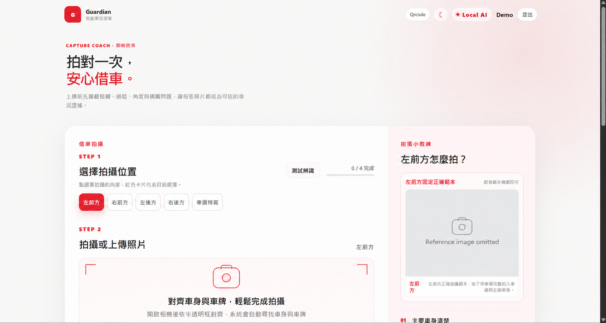
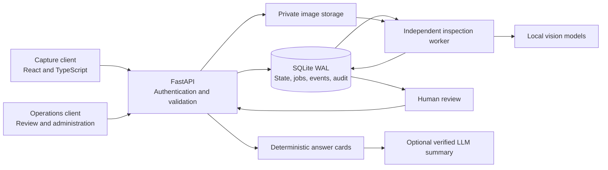

# Guardian

A local-first vehicle inspection system that connects guided image capture, asynchronous computer vision, human review, and evidence-backed operational queries.

This public source edition focuses on architecture and reusable engineering code. Operational databases, vehicle identifiers, photographs, private datasets, trained checkpoints, experiment reports, and test fixtures are excluded. The user interface currently uses Traditional Chinese; the engineering documentation is in English.

## Visual preview



AI-redacted interface preview: the display name and vehicle reference photograph were replaced for public documentation.

## Key features

- **Guided capture:** server-validated image quality, expected view, scene, and authorized rental identity.
- **Durable background analysis:** persisted jobs, worker heartbeats, retry handling, and recovery after interrupted attempts.
- **Human review:** uncertain damage and cleanliness findings remain reviewable, with source records and recorded decisions.
- **Evidence-backed history assistant:** deterministic answer cards with an optional verified, streamed language-model summary.
- **Model improvement pipeline:** task-specific labels, grouped evaluation splits, candidate comparison, and guarded promotion.

## Architecture



The diagram shows the application flow without operational data. AI results support review; they do not establish liability or authorize charges.

| Area | Source | Responsibility |
| --- | --- | --- |
| Guided capture | [apps/web](apps/web) | Camera workflow, capture hints, validation feedback |
| Operations console | [apps/ops](apps/ops) | Review queues, cases, history queries, administration |
| API | [apps/api/app](apps/api/app) | Authorization, schemas, workflow transitions, retrieval |
| Worker | [run_inspection_worker.py](scripts/run_inspection_worker.py) | Background inference and review routing |
| Pipeline tooling | [scripts](scripts) | Model preparation, training, evaluation, local development |

Read [system architecture](docs/architecture.md), [data lifecycle](docs/data-lifecycle.md), and [model pipeline](docs/model-pipeline.md) for the design details.

## Technology stack

| Layer | Technologies |
| --- | --- |
| Clients | React, TypeScript, Vite |
| API and contracts | Python, FastAPI, Pydantic |
| Persistence and jobs | SQLite WAL, private filesystem storage, independent Python worker |
| Vision | OpenCV, PyTorch, DINOv2, SigLIP2, task-specific heads, isolated RapidOCR |
| Optional generation | Ollama or configured compatible text backend, evidence verification, server-sent events |
| Source checks | GitHub Actions, Python compilation, heuristic release gate, TypeScript and Vite builds |

## Engineering challenges

| Challenge | Implemented approach | Source |
| --- | --- | --- |
| A worker can stop or finish after a retry has started | Persisted claims, heartbeats, bounded retries, and completion guarded by the attempt's `started_at` value | [Queue storage](apps/api/app/services/operations_store.py) |
| Models can be slow, missing, or uncertain | Model time limits and explicit `needs_review` results preserve a review reason; capture readiness can block unsupported inputs | [Analysis orchestration](apps/api/app/services/inspection_analysis.py), [readiness](apps/api/app/services/readiness.py) |
| Generated summaries can contradict operational records | Calculate answer cards in code, build a bounded evidence pack, and verify summary sentences before streaming them | [Answer pipeline](apps/api/app/services/history_answer.py), [summary verifier](apps/api/app/services/history_llm.py) |
| Related images can leak across evaluation splits | Validate vehicle-disjoint manifests, exclude evaluation groups when adding training samples, and compare candidates against promotion gates | [View training](scripts/train_dinov2_view_classifier.py), [training policy](apps/api/app/services/training_automation.py) |

Background processing keeps long inference away from the capture interaction. Feature caching, task-specific adapters, and optional localization reduce repeated or unnecessary work. These are optimization mechanisms; no independently verified latency or accuracy benchmark is published with this edition.

## Local demonstration

Run the application locally with your own authorized inputs. There is no hosted demonstration, bundled photo gallery, or preloaded rental dataset.

Prerequisites: Windows PowerShell, Git, Python 3.13, and Node.js 22 or later. Backend runtime requires PyTorch. Ollama is optional for generated summaries and vision-language localization.

```powershell
Copy-Item .env.example .env
.\scripts\setup.ps1
```

Base setup prepares source checks and frontend builds. Set your own bootstrap credentials in the local `.env` using [.env.example](.env.example); no default account is bundled. Remove bootstrap values after creating the first administrator.

Before starting the API and worker, install the model runtime dependencies:

```powershell
.\scripts\setup.ps1 -WithModels
# Optional: provision the isolated OCR environment as well.
.\scripts\setup.ps1 -WithOcr
.\scripts\dev.ps1
```

CPU is the default; `-TorchVariant cu126` selects the supported CUDA wheels when used with `-WithModels`. Downloads require network access and review of upstream licenses. Task-specific checkpoints must be supplied separately; see [model artifacts](models/README.md).

The development helper starts the API, worker, and both frontends on loopback interfaces. For separate terminals, activate the project environment and use:

```powershell
python -m uvicorn app.main:app --app-dir apps/api --host 127.0.0.1 --port 8000
python scripts/run_inspection_worker.py
npm run dev:web
npm run dev:ops
```

Run each command in a separate terminal. The capture client uses local HTTPS for camera access; check the browser's local certificate prompt before using the camera.

| Service | Local address |
| --- | --- |
| Capture client | [Capture application](https://localhost:5173) |
| Operations console | [Operations application](http://localhost:5174) |
| Swagger UI | [Interactive API documentation](http://127.0.0.1:8000/docs) |
| ReDoc | [API reference](http://127.0.0.1:8000/redoc) |
| Health | [Process health](http://127.0.0.1:8000/api/v1/health) |

A complete inspection requires compatible model artifacts and authorized data supplied separately. Readiness checks expose missing dependencies; capture checks may require those assets before accepting a photo. Worker model failures and timeouts route work to review. History queries retain deterministic answer cards when optional LLM generation is unavailable.

## Validation and contributions

```powershell
.\scripts\verify.ps1
```

The helper checks staged Git content for common private-artifact and identifier patterns, compiles Python source, and builds both frontends. Before staging, use `python scripts/check_public_release.py --worktree` to inspect source on disk. The release check is heuristic and cannot guarantee that every secret or personal record has been detected.

The [GitHub Actions workflow](.github/workflows/source-checks.yml) runs the index check, Python compilation, and both frontend builds. It does not deploy a service, run a full backend lint suite, report test coverage, or validate model accuracy. Behavioral and model evaluation require a separately managed, authorized dataset.

See [CONTRIBUTING.md](CONTRIBUTING.md) for setup, change review, and commit conventions.

## Deployment and licensing

This is a local engineering reference, not a production deployment package. Production use requires managed secrets, trusted TLS, access controls, request limits, backups, monitoring, and an explicit retention policy. Distributed workers require a deliberate database and object-storage migration.

Images are stored privately and served through authorized application routes. Optional external text-model backends receive query text and selected textual evidence when configured. Keep operational data, credentials, model artifacts, generated outputs, and local environment files outside the public repository.

A project license has not been selected. Third-party dependencies and model artifacts retain their own terms; this repository does not grant rights to excluded training data or third-party artifacts.
