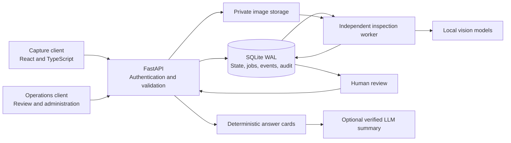

# Guardian

English | [Traditional Chinese](README.zh-TW.md)

A vehicle inspection project that brings guided capture, computer vision, human review, and inspection-history queries into one workflow.

Guardian explores how AI-assisted inspection can fit into a rental vehicle's pickup and return process. The implementation spans two React clients, a FastAPI backend, a durable analysis worker, and offline model tooling. The interface uses Traditional Chinese; documentation is available in English and Traditional Chinese.

## Problem and project goal

Vehicle inspection involves collecting comparable photos, finding changes between pickup and return, reviewing uncertain findings, and tracing a decision back to its evidence. Connecting those steps is the central design problem of this project.

The goal is to support that workflow while keeping capture responsive, model uncertainty visible, and operational answers tied to source records.

## Visual preview


AI-redacted interface preview: the display name and vehicle reference photograph were replaced for public documentation.

## Implemented workflow

1. **Capture:** guide the user through required views and validate image quality and rental identity on the server.
2. **Analyze:** pair pickup and return evidence and run vision tasks in a separate background worker.
3. **Review:** route uncertain findings to staff and retain the decision alongside its source records.
4. **Query:** build history answer cards from operational records and optionally add a verified language-model summary.
5. **Improve:** collect task-specific reviewed labels for separate offline training and evaluation.

## Implementation highlights

- **Guided capture:** server-validated image quality, expected view, scene, and authorized rental identity.
- **Durable background analysis:** persisted jobs, worker heartbeats, retry handling, and recovery after interrupted attempts.
- **Human review:** uncertain damage and cleanliness findings remain reviewable, with source records and recorded decisions.
- **Evidence-backed history assistant:** deterministic answer cards with an optional verified, streamed language-model summary.
- **Model improvement pipeline:** task-specific labels, grouped evaluation splits, candidate comparison, and guarded promotion.

## System overview



The API coordinates state, the worker handles inference, and human review closes uncertain cases. AI results support review; they do not establish liability or authorize charges.

| Area | Source | Responsibility |
| --- | --- | --- |
| Guided capture | [apps/web](apps/web) | Camera workflow, capture hints, validation feedback |
| Operations console | [apps/ops](apps/ops) | Review queues, cases, history queries, administration |
| API | [apps/api/app](apps/api/app) | Authorization, schemas, workflow transitions, retrieval |
| Worker | [run_inspection_worker.py](scripts/run_inspection_worker.py) | Background inference and review routing |
| Pipeline tooling | [scripts](scripts) | Model preparation, training, evaluation, local development |

Read [system architecture](docs/architecture.md), [data lifecycle](docs/data-lifecycle.md), and [model pipeline](docs/model-pipeline.md) for the design details.

## Technology stack

| Layer | Technologies |
| --- | --- |
| Clients | React, TypeScript, Vite |
| API and contracts | Python, FastAPI, Pydantic |
| Persistence and jobs | SQLite WAL, private filesystem storage, independent Python worker |
| Vision | OpenCV, PyTorch, DINOv2, SigLIP2, task-specific heads, isolated RapidOCR |
| Optional generation | Ollama or configured compatible text backend, evidence verification, server-sent events |
| Source checks | GitHub Actions, Python compilation, heuristic release gate, TypeScript and Vite builds |

## Engineering challenges and solutions

| Challenge | Implemented approach | Source |
| --- | --- | --- |
| A worker can stop or finish after a retry has started | Persisted claims, heartbeats, bounded retries, and completion guarded by the attempt's `started_at` value | [Queue storage](apps/api/app/services/operations_store.py) |
| Models can be slow, missing, or uncertain | Model time limits and explicit `needs_review` results preserve a review reason; capture readiness can block unsupported inputs | [Analysis orchestration](apps/api/app/services/inspection_analysis.py), [readiness](apps/api/app/services/readiness.py) |
| Generated summaries can contradict operational records | Calculate answer cards in code, build a bounded evidence pack, and verify summary sentences before streaming them | [Answer pipeline](apps/api/app/services/history_answer.py), [summary verifier](apps/api/app/services/history_llm.py) |
| Related images can leak across evaluation splits | Validate vehicle-disjoint manifests, exclude evaluation groups when adding training samples, and compare candidates against promotion gates | [View training](scripts/train_dinov2_view_classifier.py), [training policy](apps/api/app/services/training_automation.py) |

Background processing keeps long inference away from the capture interaction. Feature caching and task-specific adapters reduce repeated work; localization can be enabled when needed. Measured performance remains a separate evaluation task.

## Design decisions and tradeoffs

| Decision | Reason | Tradeoff |
| --- | --- | --- |
| Local processing and private image storage | Keep inspection evidence within the configured host | Model dependencies and storage must be provisioned locally |
| SQLite WAL and a separate worker | Persist job state with a compact single-host setup | Multi-host execution requires database and storage changes |
| Human review for uncertain results | Preserve a decision path when models fail or disagree | Some inspections still require staff time |
| Answer cards before generated summaries | Return calculated results even when the LLM is unavailable | Summary content is constrained by available evidence and verification rules |

## Scope and current limits

This portfolio includes application source, model integration, training tools, architecture notes, and a sanitized interface preview. Operational records, photographs, trained checkpoints, private datasets, and evaluation reports are not included.

There is no hosted demo or published accuracy, latency, or coverage result. A full inspection requires separately supplied model artifacts and authorized data. The current topology targets a single host; production deployment needs additional security, monitoring, backup, and retention work.

## Local demonstration

To explore the implementation locally, provide your own authorized inputs and compatible model artifacts.

Prerequisites: Windows PowerShell, Git, Python 3.13, and Node.js 22 or later. Backend runtime requires PyTorch. Ollama is optional for generated summaries and vision-language localization.

```powershell
Copy-Item .env.example .env
.\scripts\setup.ps1
```

Base setup prepares source checks and frontend builds. Set your own bootstrap credentials in the local `.env` using [.env.example](.env.example); no default account is bundled. Remove bootstrap values after creating the first administrator.

Before starting the API and worker, install the model runtime dependencies:

```powershell
.\scripts\setup.ps1 -WithModels
# Optional: provision the isolated OCR environment as well.
.\scripts\setup.ps1 -WithOcr
.\scripts\dev.ps1
```

CPU is the default; `-TorchVariant cu126` selects the supported CUDA wheels when used with `-WithModels`. Downloads require network access and review of upstream licenses. Task-specific checkpoints must be supplied separately; see [model artifacts](models/README.md).

The development helper starts the API, worker, and both frontends on loopback interfaces. The capture client uses local HTTPS for camera access; check the browser's local certificate prompt before using the camera.

| Service | Local address |
| --- | --- |
| Capture client | [Capture application](https://localhost:5173) |
| Operations console | [Operations application](http://localhost:5174) |
| Swagger UI | [Interactive API documentation](http://127.0.0.1:8000/docs) |
| ReDoc | [API reference](http://127.0.0.1:8000/redoc) |
| Health | [Process health](http://127.0.0.1:8000/api/v1/health) |

A complete inspection requires compatible model artifacts and authorized data supplied separately. Readiness checks expose missing dependencies; capture checks may require those assets before accepting a photo. Worker model failures and timeouts route work to review. History queries retain deterministic answer cards when optional LLM generation is unavailable.

## Source validation

```powershell
.\scripts\verify.ps1
```

The helper checks staged Git content for common private-artifact and identifier patterns, compiles Python source, and builds both frontends. Before staging, use `python scripts/check_public_release.py --worktree` to inspect source on disk. The release check is heuristic and cannot guarantee that every secret or personal record has been detected.

The [GitHub Actions workflow](.github/workflows/source-checks.yml) runs the index check, Python compilation, and both frontend builds. It does not deploy a service, run a full backend lint suite, report test coverage, or validate model accuracy. Behavioral and model evaluation require a separately managed, authorized dataset.

## Further reading

| Document | What it explains |
| --- | --- |
| [System architecture](docs/architecture.md) | Component boundaries, job recovery, and history-query design |
| [Data lifecycle](docs/data-lifecycle.md) | Evidence traceability, access boundaries, and retention |
| [Model pipeline](docs/model-pipeline.md) | Task-specific inference, evaluation, and model activation |

## Future work

- Establish an authorized evaluation set and measure per-task quality, review rate, and end-to-end latency.
- Add behavioral checks for recovery, authorization boundaries, and summary verification.
- Plan shared storage and coordinated job ownership before moving to multiple hosts.

## Licensing

A project license has not been selected. Third-party dependencies and model artifacts retain their own terms; this repository does not grant rights to excluded training data or third-party artifacts.
