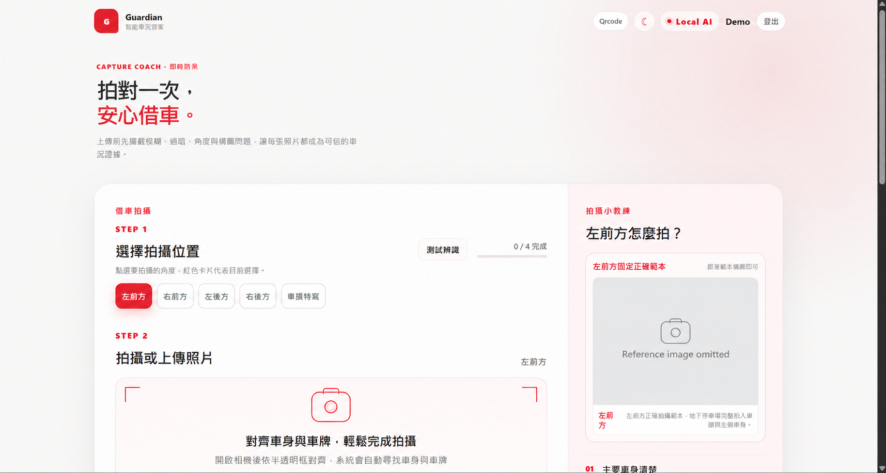
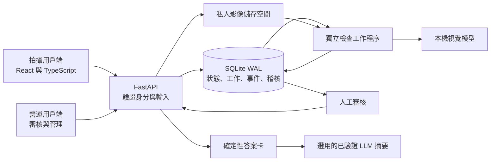

# Guardian

[English](README.md) | 繁體中文

整合引導式拍攝、電腦視覺、人工審核與檢查歷史查詢的車輛檢查專案。

Guardian 探索如何將 AI 輔助檢查整合進租賃車輛的取還車流程。實作涵蓋兩個 React 用戶端、FastAPI 後端、具持久化機制的分析工作程序，以及離線模型工具。介面採用繁體中文，文件提供英文與繁體中文版本。

## 問題背景與專案目標

車輛檢查需要收集可比較的照片、找出取還車之間的變化、審核不確定的判讀，並將決策追溯至原始證據。如何串接這些步驟，是這個專案的核心設計問題。

專案目標是在支援完整流程的同時，維持拍攝互動的流暢度、明確呈現模型的不確定性，並讓營運查詢的答案有來源紀錄可查。

## 介面預覽



此介面預覽已透過 AI 遮蔽處理：顯示名稱與車輛參考照片皆已替換，以供公開文件使用。

## 已實作的使用流程

1. **拍攝：**引導使用者完成必要視角，並由伺服器驗證影像品質與租賃身分。
2. **分析：**配對取還車證據，由獨立背景工作程序執行視覺任務。
3. **審核：**將不確定的判讀交由人員處理，並保留決策及其來源紀錄。
4. **查詢：**由營運紀錄計算歷史答案卡，並可選擇加入經驗證的語言模型摘要。
5. **改進：**收集各任務已審核的標籤，供獨立的離線訓練與評估使用。

## 實作亮點

- **引導式拍攝：**由伺服器驗證影像品質、預期視角、場景，以及授權的租賃身分。
- **可持續追蹤的背景分析：**將工作持久化，支援工作程序心跳、重試處理，以及執行中斷後的復原。
- **人工審核：**有疑慮的損傷與清潔度判讀會保留供審核，並附有來源紀錄與決策紀錄。
- **有證據支持的歷史紀錄助理：**以確定性邏輯產生答案卡，並可選用經驗證、以串流傳送的語言模型摘要。
- **模型改進流程：**使用各任務專屬標籤、分組評估切分、候選模型比較，以及設有檢核條件的模型升版流程。

## 系統概覽



API 協調狀態，工作程序處理推論，人工審核則完成有疑慮的案件。AI 結果僅供審核參考，不作為責任認定或收費授權。

| 領域 | 原始碼 | 職責 |
| --- | --- | --- |
| 引導式拍攝 | [apps/web](apps/web) | 相機操作流程、拍攝提示、驗證回饋 |
| 營運控制台 | [apps/ops](apps/ops) | 審核佇列、案件、歷史查詢、管理 |
| API | [apps/api/app](apps/api/app) | 授權、資料結構、工作流程狀態轉換、資料擷取 |
| 工作程序 | [run_inspection_worker.py](scripts/run_inspection_worker.py) | 背景推論與審核分流 |
| 流程工具 | [scripts](scripts) | 模型準備、訓練、評估、本機開發 |

設計細節請參閱[系統架構](docs/architecture.zh-TW.md)、[資料生命週期](docs/data-lifecycle.zh-TW.md)與[模型流程](docs/model-pipeline.zh-TW.md)。

## 技術組合

| 層級 | 技術 |
| --- | --- |
| 用戶端 | React、TypeScript、Vite |
| API 與資料契約 | Python、FastAPI、Pydantic |
| 持久化與工作處理 | SQLite WAL、私人檔案系統儲存、獨立 Python 工作程序 |
| 視覺 | OpenCV、PyTorch、DINOv2、SigLIP2、任務專屬預測頭、隔離執行的 RapidOCR |
| 選用的文字生成 | Ollama 或已設定的相容文字後端、證據驗證、伺服器傳送事件 |
| 原始碼檢查 | GitHub Actions、Python 編譯、啟發式發布檢查、TypeScript 與 Vite 建置 |

## 工程挑戰與解法

| 挑戰 | 已實作的方法 | 原始碼 |
| --- | --- | --- |
| 工作程序可能停止，或在重試開始後才完成 | 持久化領取紀錄、心跳、有限次重試，並以該次執行的 `started_at` 值保護完成寫入 | [佇列儲存](apps/api/app/services/operations_store.py) |
| 模型可能緩慢、缺失或無法確定結果 | 設定模型時限，透過明確的 `needs_review` 結果保留審核原因；拍攝就緒檢查可阻擋不支援的輸入 | [分析協調](apps/api/app/services/inspection_analysis.py)、[就緒檢查](apps/api/app/services/readiness.py) |
| 生成摘要可能與營運紀錄矛盾 | 以程式計算答案卡、建立範圍受限的證據集，並在串流傳送前驗證摘要句子 | [答案流程](apps/api/app/services/history_answer.py)、[摘要驗證器](apps/api/app/services/history_llm.py) |
| 相關影像可能洩漏至不同評估分組 | 驗證車輛互不重疊的資料清單，新增訓練樣本時排除評估群組，並依升版門檻比較候選模型 | [視角訓練](scripts/train_dinov2_view_classifier.py)、[訓練政策](apps/api/app/services/training_automation.py) |

背景處理讓耗時推論不影響拍攝互動。特徵快取與任務專屬介接器可減少重複運算，定位功能則視需要啟用。實際效能仍需透過獨立評估量測。

## 設計取捨

| 決策 | 原因 | 取捨 |
| --- | --- | --- |
| 本機處理與私人影像儲存 | 讓檢查證據保留在設定的主機內 | 需要在本機準備模型相依項目與儲存空間 |
| SQLite WAL 搭配獨立工作程序 | 以精簡的單機架構持久化工作狀態 | 多主機執行需要調整資料庫與儲存設計 |
| 不確定結果交由人工審核 | 模型失敗或判讀分歧時，仍保留決策途徑 | 部分檢查仍需投入人工作業時間 |
| 先回傳答案卡，再生成摘要 | LLM 無法使用時，仍能提供已計算的結果 | 摘要內容受現有證據與驗證規則限制 |

## 展示範圍與目前限制

此作品集包含應用程式原始碼、模型整合、訓練工具、架構說明與去識別化介面預覽，不包含營運紀錄、照片、訓練完成的模型檢查點、私人資料集與評估報告。

目前沒有線上示範，也未發布準確率、延遲或測試涵蓋率結果。完整檢查需要另行提供模型產物與授權資料。目前架構以單一主機為目標；正式部署仍需補足安全性、監控、備份與保留政策。

## 本機示範

若要在本機探索實作，請準備您有權使用的輸入資料與相容模型產物。

先決條件：Windows PowerShell、Git、Python 3.13，以及 Node.js 22 或更新版本。後端執行需要 PyTorch。生成摘要與視覺語言定位可選用 Ollama。

```powershell
Copy-Item .env.example .env
.\scripts\setup.ps1
```

基本安裝會準備原始碼檢查與前端建置。請依照 [.env.example](.env.example)，在本機 `.env` 設定您自己的初始帳號憑證；專案未隨附預設帳號。建立第一位管理員後，請移除初始帳號設定值。

啟動 API 與工作程序前，請安裝模型執行所需的相依套件：

```powershell
.\scripts\setup.ps1 -WithModels
# 選用：一併建置隔離的 OCR 環境。
.\scripts\setup.ps1 -WithOcr
.\scripts\dev.ps1
```

預設使用 CPU；搭配 `-WithModels` 使用 `-TorchVariant cu126` 可選擇支援的 CUDA wheel 套件。下載需要網路存取，並須檢視上游授權條款。任務專屬模型檢查點須另行提供；請參閱[模型產物](models/README.zh-TW.md)。

開發輔助腳本會在迴路介面啟動 API、工作程序與兩個前端。拍攝用戶端使用本機 HTTPS 存取相機；使用相機前，請確認瀏覽器的本機憑證提示。

| 服務 | 本機位址 |
| --- | --- |
| 拍攝用戶端 | [拍攝應用程式](https://localhost:5173) |
| 營運控制台 | [營運應用程式](http://localhost:5174) |
| Swagger UI | [互動式 API 文件](http://127.0.0.1:8000/docs) |
| ReDoc | [API 參考文件](http://127.0.0.1:8000/redoc) |
| 健康檢查 | [程序健康狀態](http://127.0.0.1:8000/api/v1/health) |

完整檢查需要另行提供相容模型產物與授權資料。就緒檢查會揭露缺少的相依項目；拍攝檢查可能要求備妥這些資源後才接受照片。工作程序遇到模型失敗或逾時時，會將工作轉交審核。即使選用的 LLM 生成功能無法使用，歷史查詢仍會保留確定性答案卡。

## 原始碼驗證

```powershell
.\scripts\verify.ps1
```

此輔助腳本會檢查 Git 暫存內容中的常見私人產物與識別資訊模式、編譯 Python 原始碼，並建置兩個前端。暫存前，可使用 `python scripts/check_public_release.py --worktree` 檢查磁碟上的原始碼。發布檢查採啟發式規則，無法保證偵測到所有機密或個人紀錄。

[GitHub Actions 工作流程](.github/workflows/source-checks.yml)會執行索引檢查、Python 編譯與兩個前端建置。它不會部署服務、執行完整的後端程式碼風格檢查、回報測試涵蓋率或驗證模型準確率。行為與模型評估需要另外管理的授權資料集。

## 延伸閱讀

| 文件 | 說明內容 |
| --- | --- |
| [系統架構](docs/architecture.zh-TW.md) | 元件邊界、工作復原與歷史查詢設計 |
| [資料生命週期](docs/data-lifecycle.zh-TW.md) | 證據追溯、存取邊界與資料保留 |
| [模型流程](docs/model-pipeline.zh-TW.md) | 任務專屬推論、評估與模型啟用 |

## 後續改進方向

- 建立授權評估資料集，量測各任務品質、人工審核比例與端到端延遲。
- 補充工作復原、授權邊界與摘要驗證的行為檢查。
- 在擴展至多主機前，規劃共用儲存與工作歸屬協調機制。

## 授權

本專案尚未選定授權條款。第三方相依套件與模型產物仍適用各自的條款；此儲存庫不授予未隨附訓練資料或第三方產物的使用權。
