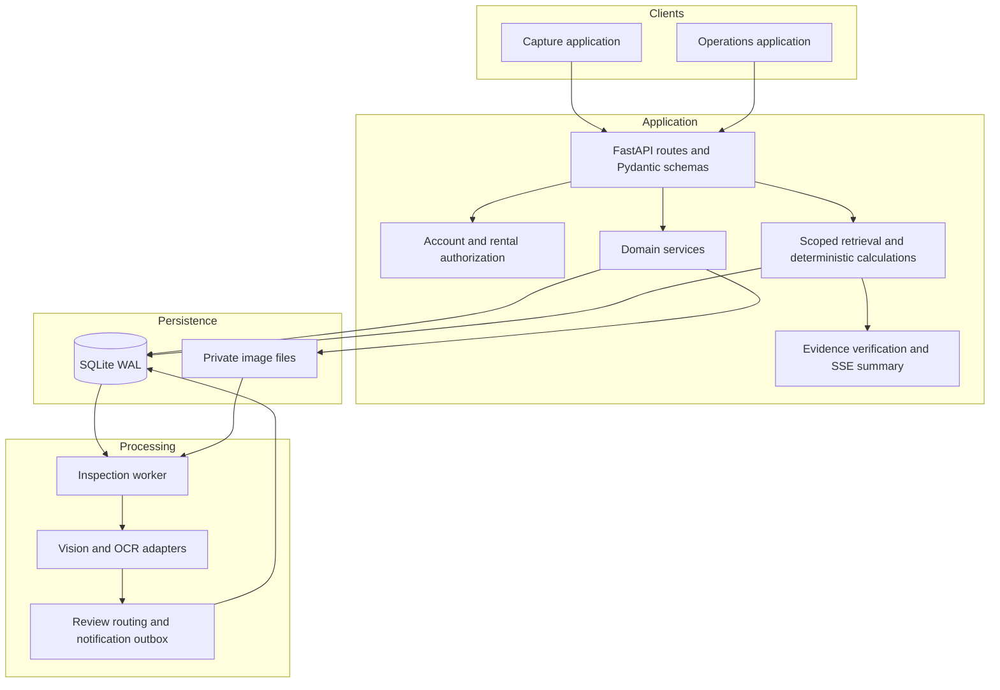
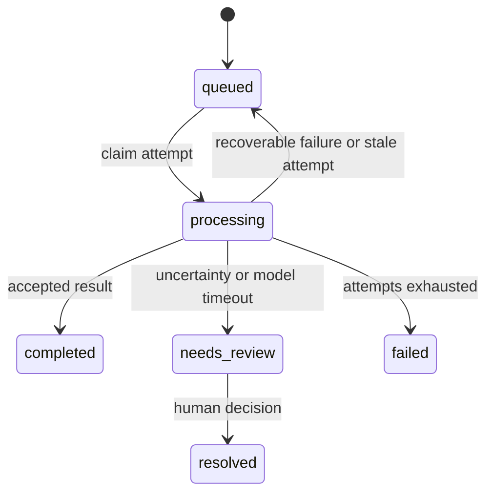

# System architecture

Guardian separates interactive capture from slow inference. The API owns validation and state transitions; a separate worker consumes durable jobs. Both frontends use the same typed API boundary.

## Runtime components

| Module | Main boundary |
| --- | --- |
| `app/api/routes` | HTTP parsing, authorization, response contracts |
| `app/schemas` | Typed requests, domain records, analysis results |
| `app/services/operations_store.py` | SQLite schema, transactions, inspection jobs, cases, events |
| `app/services/account_store.py` | Accounts, sessions, rental identity |
| `app/services/inspection_storage.py` | Private image keys and filesystem access |
| `app/services/inspection_analysis.py` | Worker orchestration and failure classification |
| `app/services/history_*` | Intent, retrieval, answer cards, evidence, summary verification |
| `app/services/active_learning.py` | Collection of reviewable learning samples |
| `app/services/runtime_settings.py` | Persisted operational settings |

## Capture and analysis flow

1. The authenticated rental context supplies the vehicle and session identity. Server authorization checks the requested scope.
2. Preview provides capture guidance. A preflight check validates uploads and evaluates quality, expected view, scene, and identity where required.
3. Final submission validates again, writes the private image, and records its index. Preflight success does not bypass server validation.
4. Pickup images remain available for pairing. Completing the return workflow queues analysis for the corresponding inspection sessions.
5. The worker claims a persisted job, reads the authorized source images, and invokes the appropriate model adapter.
6. Results update the job and create reviewable domain records. Human confirmation completes the operational case and records the decision.

Close-up damage images carry their intended view and follow a different validation path from the standard exterior captures.

## Durable queue and recovery

The queue lives in `inspection_analysis_jobs`. Claim and completion operations use transactions. A worker records a heartbeat while it processes a job. Stale attempts can be recovered, and retryable failures use bounded attempts and backoff.

Completion is guarded by the attempt's `started_at` value so that an obsolete worker cannot overwrite a newer attempt. Recorded inference duration excludes time spent waiting in the queue. Capacity limits provide backpressure before work is accepted.

Automated routing can run in shadow mode: recommendations are recorded while human review remains authoritative. Model errors and timeouts preserve an explicit review reason rather than a successful assessment.

## Evidence-backed history queries

The history assistant first resolves scope and intent, retrieves matching records, and calculates a structured answer card in application code. This card is useful without a language model.

An optional model receives a bounded evidence pack and produces a short summary. The summary verifier checks supported facts and references before exposing sentences. Server-sent events deliver the card first, then generation status and accepted summary text. Busy, unavailable, timed-out, or unsupported generation preserves the deterministic result.

This retrieval path uses domain records and deterministic calculations; it does not require a vector database. Event identifiers connect cards and citations to their source records.

## Persistence and integration boundaries

SQLite WAL stores structured state and queue ownership. Private files hold uploaded images and learning artifacts. File references use application-controlled keys; images are not exposed as a public static directory.

The notification outbox records durable intent before an optional delivery adapter exports work for external automation. Event keys prevent duplicate intent. Delivery acknowledgement remains distinct from queue insertion.

Runtime settings may override environment defaults after initialization. Review both sources when reproducing model behavior. [Data lifecycle](data-lifecycle.md) describes ownership, retention, and traceability; [model pipeline](model-pipeline.md) describes inference and promotion.

## Operational limits

The current topology targets one host with local storage. A multi-host deployment would need shared object storage, database coordination, worker leasing, and a managed delivery mechanism. Local development HTTPS and process helpers do not provide a complete production security or availability design.
