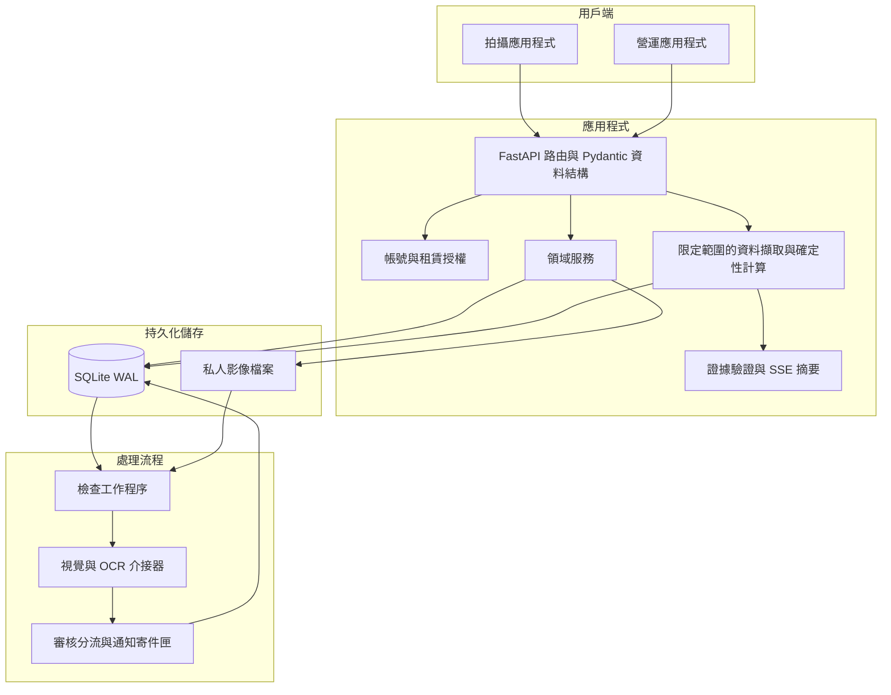
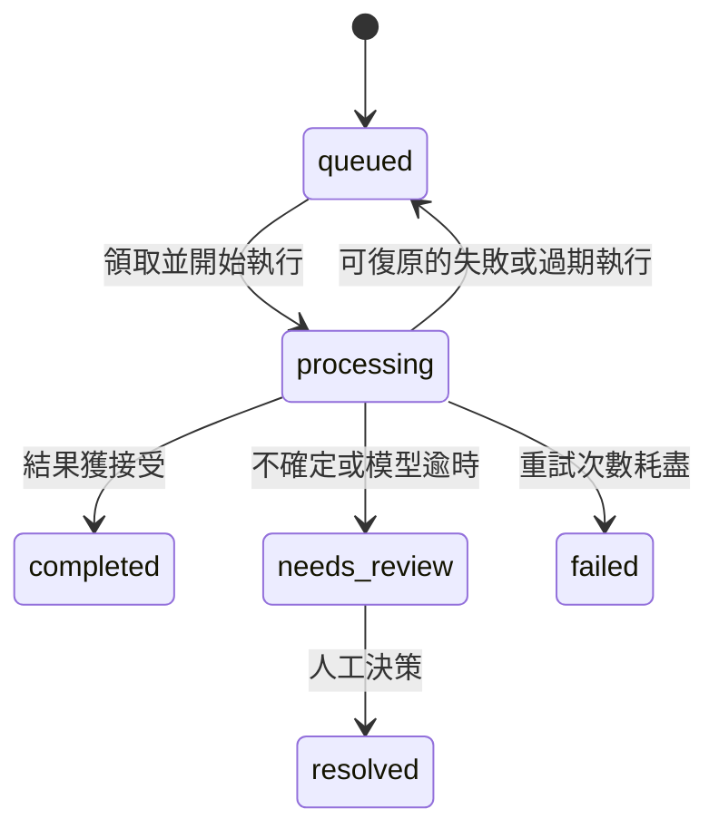

# 系統架構

[English](architecture.md) | 繁體中文

Guardian 的架構處理三個工程問題：耗時推論期間維持拍攝互動、復原中斷的分析，以及讓歷史查詢答案能追溯至紀錄。API 負責驗證與狀態轉換；獨立工作程序則處理持久化工作。兩個前端共用相同的具型別 API 邊界。

## 設計理由

| 問題 | 設計選擇 | 帶來的影響 |
| --- | --- | --- |
| 推論可能超過互動請求的等待時間 | 將拍攝驗證與佇列分析分開 | 介面需要呈現處理中與待審核狀態 |
| 工作程序可能停止或延遲回傳 | 持久化工作歸屬、心跳與執行保護條件 | 復原時必須區分當前執行與過期工作 |
| 模型文字可能偏離既有事實 | 先計算答案卡，再生成摘要 | 摘要需要範圍受限的證據與驗證層 |
| 本機流程需要精簡的持久化設計 | 使用 SQLite WAL 與私人檔案 | 多主機運作需要不同的協調與儲存設計 |

## 執行階段元件

| 模組 | 主要職責邊界 |
| --- | --- |
| `app/api/routes` | HTTP 解析、授權、回應契約 |
| `app/schemas` | 具型別的請求、領域紀錄、分析結果 |
| `app/services/operations_store.py` | SQLite 資料結構、交易、檢查工作、案件、事件 |
| `app/services/account_store.py` | 帳號、工作階段、租賃身分 |
| `app/services/inspection_storage.py` | 私人影像索引鍵與檔案系統存取 |
| `app/services/inspection_analysis.py` | 工作程序協調與失敗分類 |
| `app/services/history_*` | 意圖、資料擷取、答案卡、證據、摘要驗證 |
| `app/services/active_learning.py` | 收集可供審核的學習樣本 |
| `app/services/runtime_settings.py` | 持久化的營運設定 |

## 拍攝與分析流程

1. 已驗證的租賃情境提供車輛與工作階段身分。伺服器授權檢查請求範圍。
2. 預覽提供拍攝引導。預先檢查會驗證上傳內容，並視需要評估品質、預期視角、場景與身分。
3. 正式提交時會再次驗證、寫入私人影像並記錄索引。通過預先檢查並不會略過伺服器驗證。
4. 取車影像會保留供配對使用。完成還車流程後，系統會將對應檢查工作階段的分析加入佇列。
5. 工作程序領取已持久化的工作、讀取授權來源影像，並呼叫適當的模型介接器。
6. 結果會更新工作並建立可供審核的領域紀錄。人工確認後完成營運案件，並記錄決策。

損傷近照會攜帶其預期視角資訊，並採用與標準車外拍攝不同的驗證流程。

## 持久化佇列與復原

佇列儲存於 `inspection_analysis_jobs`。領取與完成操作皆使用交易。工作程序處理工作時會記錄心跳。過期的執行嘗試可復原；可重試的失敗則採用有限次數與退避機制。

完成操作以該次執行的 `started_at` 值作為保護條件，避免過期工作程序覆寫較新的執行結果。記錄的推論時間不包含佇列等待時間。容量限制會在接受工作前提供背壓控制。

自動分流可在影子模式下運作：系統記錄建議，但仍以人工審核為準。模型錯誤與逾時會保留明確的審核原因，而非視為成功完成判讀。

## 有證據支持的歷史查詢

歷史紀錄助理會先解析範圍與意圖、擷取符合條件的紀錄，再由應用程式以程式碼計算結構化答案卡。即使沒有語言模型，這張卡仍可使用。

選用的模型會接收範圍受限的證據集並產生簡短摘要。摘要驗證器會先檢查事實支持與參照來源，再顯示句子。伺服器傳送事件會先送出答案卡，再傳送生成狀態與通過驗證的摘要文字。生成服務忙碌、不可用、逾時或產出缺乏支持的內容時，仍保留確定性結果。

此資料擷取流程使用領域紀錄與確定性計算，不需要向量資料庫。事件識別碼會將答案卡與引用連結至來源紀錄。

## 持久化與整合邊界

SQLite WAL 儲存結構化狀態與佇列工作歸屬。私人檔案保存上傳影像與學習產物。檔案參照使用應用程式控制的索引鍵；影像不會以公開靜態目錄提供。

通知寄件匣會先持久化記錄通知意圖，再由選用的傳送介接器將工作匯出至外部自動化系統。事件索引鍵可防止重複建立通知意圖。傳送確認與加入佇列是不同的動作。

執行階段設定可能在初始化後覆寫環境預設值。重現模型行為時，請同時檢視這兩個來源。[資料生命週期](data-lifecycle.zh-TW.md)說明資料歸屬、保留與可追溯性；[模型流程](model-pipeline.zh-TW.md)說明推論與升版。

## 營運限制

目前的拓撲以單一主機與本機儲存為目標。多主機部署需要共用物件儲存、資料庫協調、工作程序租約與受管理的傳送機制。本機開發用 HTTPS 與程序輔助腳本，並未提供完整的正式環境安全性或可用性設計。

## 程式碼導讀

可先從[檢查分析](../apps/api/app/services/inspection_analysis.py)了解工作程序協調，再閱讀[佇列儲存](../apps/api/app/services/operations_store.py)中的持久化狀態與執行保護條件。查詢流程則可搭配閱讀[答案準備與串流](../apps/api/app/services/history_answer.py)及[摘要驗證](../apps/api/app/services/history_llm.py)。

[專案概覽](../README.zh-TW.md) · [資料生命週期](data-lifecycle.zh-TW.md) · [模型流程](model-pipeline.zh-TW.md)
