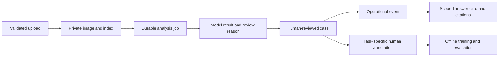

# Data lifecycle and traceability

English | [Traditional Chinese](data-lifecycle.zh-TW.md)

An inspection result needs context: which image was analyzed, which job produced the finding, and who confirmed the decision. Guardian links those records so review and history queries can follow the same evidence chain.

This document explains that data design and the boundary between the portfolio's source code and private runtime information.

## Design focus

- **Traceability:** connect images, jobs, cases, and events through identifiers.
- **Separate observations from decisions:** preserve model findings and human actions as distinct records.
- **Controlled access:** serve private images through authorized application routes.
- **Task-specific learning:** keep reviewed labels attached to their source and intended task.

## Data scope

| Data | Runtime purpose | Public repository policy |
| --- | --- | --- |
| Accounts and sessions | Authentication and authorization | Excluded; bootstrap explicitly |
| Inspection images | Capture evidence and paired analysis | Excluded |
| SQLite database and sidecars | Workflow state, jobs, cases, events, audit | Excluded |
| OCR output and vehicle identity | Authorized inspection matching | Excluded |
| Human labels and annotations | Review and future model evaluation | Excluded |
| Model checkpoints and feature caches | Task inference and offline training | Excluded |
| Logs, exports, notifications | Operations and delivery | Excluded |
| Source schemas and services | Reusable engineering implementation | Included |

## Runtime flow

The image index, session, job, case, and event identifiers form the traceability chain. A model result is a recorded observation; a human decision is a separate workflow action. Preserve both when investigating why a case changed state.

## Collection and access

Preview frames support capture guidance without becoming a stored inspection record. Formal uploads are validated for type and size, checked by server-side workflow rules, and written to private storage. The database records the relationship between files and inspection sessions.

Rental users operate within their own authorized scope. Operations staff review relevant records; administrative settings, accounts, and model management have additional role checks. Use application routes to retrieve images so authorization remains part of the access path.

Keep local environment files and credentials out of version control. Runtime database files, including WAL and shared-memory sidecars, must be handled as one persistence boundary. Checkpoint metadata, manifests, and feature stores can contain source paths or sample identifiers even when no photograph is attached.

## Review and learning

Learning samples preserve task, source, label, and review state. Separate view classification, cleanliness, paired damage, and OCR tasks to avoid treating unrelated labels as interchangeable ground truth.

Human confirmation is not a model release. Training and promotion require separate, task-specific evaluation. Keep evaluation splits grouped by vehicle or capture session where necessary to prevent paired or near-duplicate images crossing the training boundary.

## Retention and deletion

Delete runtime records through the supported application workflow so indexes, case state, and files remain consistent. Hiding a queue item is not deletion of its evidence. Before destructive cleanup, identify dependencies such as open cases, paired pickup/return images, and approved learning samples.

The application has retention handling for operational activity records. Configure broader image, event, export, and backup retention for the environment where the system is used. Archived activity and generated exports remain data that require access controls and eventual disposal.

Back up SQLite using a consistent database backup method. Coordinate image and database backups so restored object references resolve. A Git checkout does not restore runtime files or model artifacts.

## Portfolio presentation

The portfolio demonstrates the flow through source code, diagrams, and a [sanitized interface preview](assets/guardian-demo-redacted.png). The preview replaces the display name and vehicle reference photograph. Operational samples, original screenshots, generated reports, embeddings, and private model metadata are not included. This keeps the design inspectable without publishing inspection evidence.

External text-model backends, when explicitly configured, receive the query and selected textual evidence. Review that evidence scope before enabling such an integration. Local image processing alone does not determine the data boundary of every optional service.

## Code walkthrough

[Image storage](../apps/api/app/services/inspection_storage.py) defines file access, [operations storage](../apps/api/app/services/operations_store.py) connects workflow records, and [active learning](../apps/api/app/services/active_learning.py) collects reviewable samples.

[Project overview](../README.md) · [System architecture](architecture.md) · [Model pipeline](model-pipeline.md)
