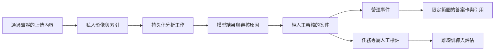

# 資料生命週期與可追溯性

[English](data-lifecycle.md) | 繁體中文

一份檢查結果需要脈絡：分析的是哪張影像、哪個工作產生判讀，以及誰確認了決策。Guardian 將這些紀錄串接起來，讓審核與歷史查詢能沿著相同的證據鏈追溯。

本文件說明這項資料設計，以及作品集原始碼與私人執行階段資訊之間的邊界。

## 設計重點

- **可追溯性：**透過識別碼串接影像、工作、案件與事件。
- **分開記錄觀察與決策：**模型判讀與人工動作各自保留紀錄。
- **受控存取：**透過需授權的應用程式路由提供私人影像。
- **任務專屬學習：**審核標籤保留其來源與對應任務。

## 資料範圍

| 資料 | 執行階段用途 | 公開儲存庫政策 |
| --- | --- | --- |
| 帳號與工作階段 | 身分驗證與授權 | 不隨附；須明確執行初始設定 |
| 檢查影像 | 拍攝證據與配對分析 | 不隨附 |
| SQLite 資料庫與附屬檔案 | 工作流程狀態、工作、案件、事件、稽核 | 不隨附 |
| OCR 輸出與車輛身分 | 授權檢查比對 | 不隨附 |
| 人工標籤與標註 | 審核與後續模型評估 | 不隨附 |
| 模型檢查點與特徵快取 | 任務推論與離線訓練 | 不隨附 |
| 日誌、匯出檔案、通知 | 營運與傳送 | 不隨附 |
| 原始碼資料結構與服務 | 可重用的工程實作 | 隨附 |

## 執行階段流程

影像索引、工作階段、工作、案件與事件的識別碼形成可追溯鏈。模型結果是已記錄的觀察；人工決策則是獨立的工作流程動作。調查案件狀態變更原因時，應同時保留兩者。

## 收集與存取

預覽影格用於拍攝引導，不會成為已儲存的檢查紀錄。正式上傳內容會經過類型與大小驗證、伺服器端工作流程規則檢查，再寫入私人儲存空間。資料庫會記錄檔案與檢查工作階段之間的關係。

租賃使用者只能在自身授權範圍內操作。營運人員審核相關紀錄；管理設定、帳號與模型管理另有角色檢查。請透過應用程式路由取得影像，使授權始終是存取流程的一部分。

請勿將本機環境檔案與憑證納入版本控制。執行階段資料庫檔案，包括 WAL 與共用記憶體附屬檔案，必須視為同一持久化邊界處理。即使未附照片，模型檢查點中繼資料、資料清單與特徵儲存仍可能含有來源路徑或樣本識別碼。

## 審核與學習

學習樣本保留任務、來源、標籤與審核狀態。請區分視角分類、清潔度、配對損傷與 OCR 任務，避免將無關標籤視為可互換的真實標準。

人工確認不等於模型發布。訓練與升版需要各任務獨立的評估。必要時應依車輛或拍攝工作階段分組切分評估資料，避免成對或近乎重複的影像跨越訓練邊界。

## 保留與刪除

請透過支援的應用程式流程刪除執行階段紀錄，使索引、案件狀態與檔案保持一致。隱藏佇列項目不等於刪除其證據。進行破壞性清理前，請先辨識尚未結案的案件、成對的取還車影像，以及已核准學習樣本等相依關係。

應用程式具備營運活動紀錄的保留處理功能。請依系統使用環境，設定更完整的影像、事件、匯出檔案與備份保留政策。封存活動與生成的匯出檔案仍屬資料，需要存取控制及最終處置。

請使用能確保資料庫一致性的備份方法備份 SQLite。影像與資料庫備份應互相協調，使還原後的物件參照可正確解析。Git 簽出無法還原執行階段檔案或模型產物。

## 作品集呈現方式

作品集透過原始碼、圖表與[去識別化介面預覽](assets/guardian-demo-redacted.png)展示流程。預覽中的顯示名稱與車輛參考照片已替換；營運樣本、原始截圖、生成報告、嵌入向量與私人模型中繼資料皆不隨附。讀者可以檢視設計，而不需公開檢查證據。

明確設定外部文字模型後端後，它會接收查詢與選定的文字證據。啟用此類整合前，請檢視證據範圍。僅在本機處理影像，並不代表所有選用服務都具有相同的資料邊界。

## 程式碼導讀

[影像儲存](../apps/api/app/services/inspection_storage.py)定義檔案存取方式，[營運儲存](../apps/api/app/services/operations_store.py)串接工作流程紀錄，[主動學習](../apps/api/app/services/active_learning.py)則負責收集可供審核的樣本。

[專案概覽](../README.zh-TW.md) · [系統架構](architecture.zh-TW.md) · [模型流程](model-pipeline.zh-TW.md)
