# Model pipeline

English | [Traditional Chinese](model-pipeline.zh-TW.md)

Guardian integrates multiple vision tasks into one inspection workflow. The engineering focus is on how model outputs become usable application states: capture validation, background findings, review decisions, and separately evaluated model updates.

Synchronous capture validation, background analysis, and offline improvement have separate execution paths. Model adapters return structured results and explicit uncertainty so the workflow can preserve human review.

## Design rationale

| Choice | Reason | Tradeoff |
| --- | --- | --- |
| Task-specific adapters and prediction heads | Give view, damage, cleanliness, and OCR tasks their own contracts | Each task needs compatible artifacts and evaluation |
| Isolated OCR subprocess | Bound recognition time and separate runtime dependencies | Adds environment provisioning and process coordination |
| Paired pickup/return comparison | Evaluate changes against a corresponding earlier view | Depends on compatible views and image quality |
| Separate training from activation | Require evaluation and an explicit promotion decision | Reviewed labels do not immediately change runtime behavior |

## Inference stages

| Stage | Implementation approach | Operational boundary |
| --- | --- | --- |
| File and quality checks | Upload validation, OpenCV, optional blur classifier | Reject invalid input before persistent analysis |
| Exterior and interior views | DINOv2 feature extractors and task-specific heads | Require compatible classes, artifacts, and confidence thresholds |
| Vehicle coverage | Object detection and composition checks | Assess whether the intended subject is usable |
| OCR | Isolated RapidOCR subprocess | Time-bounded recognition and authorized identity comparison |
| Paired damage | Geometric alignment and SigLIP2/DINOv2 patch comparison | Compare compatible pickup/return views; uncertain changes need review |
| Interior cleanliness | Seat-specific feature models and localization | Treat scores and regions as review cues |
| Optional localization | Local vision-language model | Add detail only when configured and available |
| History summaries | Deterministic cards plus verified model text | Preserve the card when generated text cannot be verified |

These are implementation methods, not accuracy guarantees. Specialized heads and private calibration material are excluded. Third-party backbone licenses and compatible artifact formats must be checked before provisioning models.

## Readiness and failure handling

Health indicates that the API process responds. Readiness evaluates dependencies such as database access, model files, compatible checkpoint metadata, local backbone caches, and optional model services. A healthy API can still lack the assets needed to accept or analyze an inspection.

Capture gates may block acceptance when required models are missing. During worker execution, model unavailability, invalid responses, and inference timeouts produce an explicit review result. Missing source files or other processing failures enter the queue's bounded retry path. Successful process execution must not be interpreted as a positive inspection result.

Provision compatible artifacts separately under the paths described by configuration and [models/README.md](../models/README.md). Public backbone download helpers do not recreate the excluded task-specific heads or private training data.

## Offline improvement

```mermaid
flowchart LR
    Observations[Capture and review observations] --> Labels[Task-specific human labels]
    Labels --> Split[Grouped training and evaluation splits]
    Split --> Features[Versioned feature extraction]
    Features --> Candidate[Candidate model]
    Candidate --> Evaluation[Held-out metrics and failure analysis]
    Evaluation --> Promotion[Explicit promotion decision]
    Promotion --> Registry[Artifact version and provenance]
    Registry --> Runtime[Configured runtime adapter]
```

Keep sample selection, training, evaluation, and activation as distinct actions. Review approval alone does not release a new model. Existing task guards protect incompatible or unapproved artifacts from becoming active merely because a file exists.

For each candidate, keep the following in a private artifact registry:

- Task, architecture, class mapping, feature preprocessing, and required backbones.
- Training configuration, grouped split definitions, dataset provenance, and consent or usage constraints.
- Held-out metrics, uncertainty thresholds, failure examples, and environment-specific latency.
- Artifact hash, dependency versions, approval decision, active version, and rollback target.

Avoid promoting on aggregate accuracy alone. Compare acceptance coverage, per-class failures, and behavior under missing views, blur, illumination changes, and near-duplicate inputs. Confidence scores are not automatically calibrated probabilities.

## Training and evaluation tools

| Script | Purpose and required private inputs |
| --- | --- |
| `prepare_view_dataset.py` | Builds a local dataset from an explicitly supplied workbook and image directory |
| `train_dinov2_view_classifier.py` | Trains view-classification heads from your prepared manifests and features |
| `train_blur_detector.py` | Trains from `--sharp-manifest` and requires separate `--real-blur-dir` and `--normal-test-dir` evaluation inputs |
| `export_damage_pair_dataset.py` | Exports authorized paired images and labels from your local operational store |
| `damage_pair_autolearn.py` | Trains and evaluates paired-damage candidates from an exported dataset |
| `import_damage_pair_model.py` | Inspects and imports a supplied candidate; `--dry-run` verifies without installation |
| `run_active_learning_cycle.py` | Runs the supported local candidate-training workflow against your own reviewed samples |

All scripts are under `scripts/`. Read their `--help` output before running them. Training outputs, cached features, exported archives, and evaluation examples remain private runtime artifacts. In particular, the blur trainer requires explicit evaluation inputs and does not bundle a reference dataset. Review promotion results before using activation options.

## Reproducibility

The repository provides source for model integration and reusable training workflows. It does not publish a benchmark result or claim that the original model can be reproduced without the excluded artifacts and data. Validate the environment, supply authorized data, train or provision compatible heads, and record your own evaluation before enabling an operational workflow.

## Evaluation priorities

Future evaluation should measure per-task quality, the share of cases sent to review, and latency in a recorded runtime environment. Grouped splits and failure analysis are needed before comparing candidate models. These are evaluation goals; this portfolio does not report measured results.

[Project overview](../README.md) · [System architecture](architecture.md) · [Model artifacts](../models/README.md)
