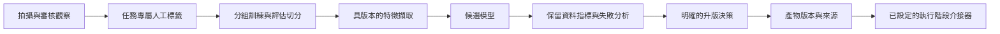

# 模型流程

[English](model-pipeline.md) | 繁體中文

Guardian 將多項視覺任務整合進同一個檢查流程。工程重點在於如何將模型輸出轉成應用程式可使用的狀態：拍攝驗證、背景判讀、審核決策，以及經過獨立評估的模型更新。

同步拍攝驗證、背景分析與離線改進各有獨立執行路徑。模型介接器會回傳結構化結果與明確的不確定性資訊，讓工作流程保留人工審核機制。

## 設計理由

| 選擇 | 原因 | 取捨 |
| --- | --- | --- |
| 任務專屬介接器與預測頭 | 讓視角、損傷、清潔度與 OCR 各自擁有明確契約 | 每項任務都需要相容產物與獨立評估 |
| 隔離的 OCR 子程序 | 限制辨識時間並分離執行相依項目 | 增加環境準備與程序協調工作 |
| 配對比較取還車影像 | 依對應的先前視角評估變化 | 依賴相容視角與影像品質 |
| 訓練與啟用分開 | 要求先評估，再明確決定是否升版 | 已審核標籤不會立即改變執行行為 |

## 推論階段

| 階段 | 實作方法 | 營運邊界 |
| --- | --- | --- |
| 檔案與品質檢查 | 上傳驗證、OpenCV、選用的模糊分類器 | 在持久化分析前拒絕無效輸入 |
| 車外與車內視角 | DINOv2 特徵擷取器與任務專屬預測頭 | 需要相容的類別、產物與信心門檻 |
| 車輛涵蓋範圍 | 物件偵測與構圖檢查 | 評估目標主體是否可用 |
| OCR | 隔離的 RapidOCR 子程序 | 限時辨識與授權身分比對 |
| 配對損傷 | 幾何對齊與 SigLIP2/DINOv2 影像區塊比較 | 比較相容的取還車視角；有疑慮的變化需審核 |
| 車內清潔度 | 座椅專屬特徵模型與定位 | 將分數與區域作為審核線索 |
| 選用定位 | 本機視覺語言模型 | 僅在完成設定且可用時補充細節 |
| 歷史摘要 | 確定性答案卡搭配已驗證的模型文字 | 生成文字無法驗證時保留答案卡 |

這些是實作方法，不代表準確率保證。專用預測頭與私人校準資料不隨附。建置模型環境前，必須確認第三方骨幹模型授權條款與相容產物格式。

## 就緒檢查與失敗處理

健康檢查表示 API 程序能回應。就緒檢查則評估資料庫存取、模型檔案、相容的檢查點中繼資料、本機骨幹模型快取與選用模型服務等相依項目。健康的 API 仍可能缺少接受或分析檢查所需的資源。

缺少必要模型時，拍攝檢核機制可能阻擋接收。工作程序執行期間，模型不可用、回應無效與推論逾時會產生明確的待審核結果。來源檔案缺失或其他處理失敗則會進入佇列的有限次重試流程。程序成功執行，不得解讀為檢查合格。

請依設定與 [models/README.zh-TW.md](../models/README.zh-TW.md) 說明的路徑，另行配置相容產物。公開骨幹模型下載工具不會重建未隨附的任務專屬預測頭或私人訓練資料。

## 離線改進

請將樣本選取、訓練、評估與啟用視為不同動作。單純通過審核不會發布新模型。既有任務防護條件可避免不相容或未經核准的產物僅因檔案存在就被啟用。

每個候選模型都應在私人產物登錄系統保留下列資訊：

- 任務、架構、類別對應、特徵前處理與所需骨幹模型。
- 訓練設定、分組切分定義、資料集來源，以及同意或使用限制。
- 保留資料評估指標、不確定性門檻、失敗範例，以及特定環境的延遲。
- 產物雜湊值、相依套件版本、核准決策、啟用版本與回復目標。

避免僅憑整體準確率升版。請比較接受涵蓋率、各類別失敗情形，以及缺少視角、模糊、光照變化與近乎重複輸入時的行為。信心分數不一定是經過校準的機率。

## 訓練與評估工具

| 腳本 | 用途與必要的私人輸入 |
| --- | --- |
| `prepare_view_dataset.py` | 從明確提供的活頁簿與影像目錄建立本機資料集 |
| `train_dinov2_view_classifier.py` | 使用您準備的資料清單與特徵訓練視角分類預測頭 |
| `train_blur_detector.py` | 從 `--sharp-manifest` 訓練，並要求另外提供 `--real-blur-dir` 與 `--normal-test-dir` 評估輸入 |
| `export_damage_pair_dataset.py` | 從本機營運儲存匯出已授權的配對影像與標籤 |
| `damage_pair_autolearn.py` | 使用匯出資料集訓練與評估配對損傷候選模型 |
| `import_damage_pair_model.py` | 檢查並匯入提供的候選模型；`--dry-run` 可僅驗證而不安裝 |
| `run_active_learning_cycle.py` | 使用您已審核的樣本執行支援的本機候選模型訓練流程 |

所有腳本皆位於 `scripts/`。執行前請閱讀其 `--help` 輸出。訓練輸出、快取特徵、匯出封存檔案與評估範例皆屬私人執行階段產物。尤其是模糊偵測訓練器，必須明確提供評估輸入，且不隨附參考資料集。使用啟用選項前，請先審查升版結果。

## 可重現性

此儲存庫提供模型整合與可重用訓練流程的原始碼，不發布基準測試結果，也不宣稱能在缺少未隨附產物與資料的情況下重現原始模型。啟用營運流程前，請驗證環境、提供授權資料、訓練或配置相容預測頭，並記錄您自己的評估。

## 評估優先項目

後續評估應量測各任務品質、轉交人工審核的案件比例，以及在明確記錄的執行環境中的延遲。比較候選模型前，需要分組切分與失敗分析。這些是評估目標；此作品集未提供量測結果。

[專案概覽](../README.zh-TW.md) · [系統架構](architecture.zh-TW.md) · [模型產物](../models/README.zh-TW.md)
